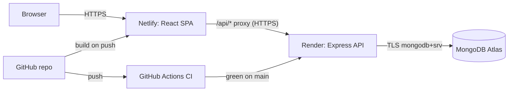

# TechFest 2026 Portal: Deployment Report

**Course:** Web Technology Laboratory (23CSB40B)
**Objective:** Secure the MERN application against common OWASP vulnerabilities, manage it with
Git/GitHub, configure a CI pipeline, deploy it to the cloud, and analyse and improve its performance.

> Items marked **TODO** need your own GitHub / Atlas / Render / Netlify accounts. Fill them in after
> following section 6. Everything else was implemented and verified locally.

---

## 1. Application architecture

```
 Browser (any device)
     │  HTTPS  https://<site>.netlify.app
     ▼
 ┌──────────────────────────────┐
 │ Netlify  (React build, CDN)  │  static files: minified, hashed, cached 1 year
 │  /*      -> index.html       │  security headers (CSP, HSTS, X-Frame-Options...)
 │  /api/*  -> proxy ──────────────────┐
 └──────────────────────────────┘     │ HTTPS
                                      ▼
                    ┌──────────────────────────────────┐
                    │ Render  (Node.js 22 + Express)   │  Helmet, mongo-sanitize,
                    │  /api/auth, /api/events, ...     │  express-validator, JWT cookie,
                    └──────────────────────────────────┘  rate limiting, compression
                                      │ TLS (mongodb+srv)
                                      ▼
                    ┌──────────────────────────────────┐
                    │ MongoDB Atlas (M0 free cluster)  │  users, events,
                    │  db: techfest2026                │  registrations, feedback
                    └──────────────────────────────────┘
```



**Why Netlify proxies `/api`:** the browser only ever talks to one origin (the Netlify site). This
means the session cookie is first-party, so `SameSite=Strict` works and Safari/iOS (which block
third-party cookies) can still log in. It also means no CORS preflight on every request.
`VITE_API_URL` is used at build time to write that proxy rule (`client/scripts/write-redirects.mjs`).

## 2. Deployment URLs

| Part | URL |
| --- | --- |
| Frontend (Netlify) | **TODO** `https://__________.netlify.app` |
| Backend health check (Render) | **TODO** `https://__________.onrender.com/api/health` |
| Database | MongoDB Atlas cluster **TODO** `cluster0.xxxxx.mongodb.net` (not public) |
| GitHub repository | **TODO** `https://github.com/__________/Techfest-deployment` |

## 3. Security (Questions 1 and 2)

### 3.1 Vulnerabilities identified and fixes

| # | OWASP Top 10 (2021) | Vulnerability | Fix in this project | Evidence |
| --- | --- | --- | --- | --- |
| 1 | A03 Injection | **NoSQL login bypass**: `{"email":{"$ne":null},"password":{"$ne":null}}` logs in as the first user | `express-mongo-sanitize` strips `$`/`.` keys; `express-validator` requires email/password to be *strings* (`server/src/routes/auth.js`); query by email only, then bcrypt compare | `tests/security.test.js`, `docs/security/attack-output.txt` |
| 2 | A03 Injection (XSS) | **Stored XSS**: `<script>alert('hi')</script>` in feedback runs for every visitor | React renders feedback as a text node (no `dangerouslySetInnerHTML`); API returns JSON only; Helmet CSP `script-src 'self'` on API, strict CSP on Netlify | `Feedback.jsx`, `docs/security/secure-mode-xss-escaped.png` |
| 3 | A01 Broken Access Control / CSRF | Forged request from another site using the victim's cookie | Cookie `SameSite=Strict`; API rejects state-changing requests whose `Origin` is not `CLIENT_ORIGIN` (`middleware/csrf.js`); CORS limited to `CLIENT_ORIGIN` | `security.test.js` → "blocks state-changing requests from a foreign origin" |
| 4 | A02 Cryptographic Failures | Token theft or sniffing, plaintext passwords | HTTPS everywhere (Netlify/Render/Atlas TLS), HSTS; JWT in `httpOnly` + `secure` cookie (JS can't read it); bcrypt cost 12; `JWT_SECRET` ≥ 32 chars enforced in production | `middleware/auth.js`, `config.js` |
| 5 | A05 Security Misconfiguration | Missing headers, `X-Powered-By`, stack traces in errors | Helmet (CSP, HSTS, nosniff, frame options, referrer policy), `x-powered-by` disabled, generic 500 messages in production, 10 kB body limit | `security.test.js` → "security headers" |
| 6 | A07 Identification & Auth Failures | Password brute force, user enumeration | `express-rate-limit` 20 attempts / 15 min on `/api/auth`; same error for unknown email and wrong password; password policy (8+ chars, letter + number) | `routes/auth.js` |
| 7 | A04 Insecure Design | Two users taking the last seat | Atomic `findOneAndUpdate` with `$expr: registeredCount < capacity`; unique index on (user, event) | `events.test.js` → "refuses registration when the event is full" |
| 8 | A06 Vulnerable Components | Known-vulnerable packages | `npm audit --omit=dev --audit-level=high` runs in CI (currently 0 production vulnerabilities) | `.github/workflows/ci.yml` |
| 9 | Secrets exposure | `.env` or keys pushed to GitHub | `.gitignore` excludes `node_modules` and `.env*`; secrets only in Render/Netlify env settings; `.env.example` has placeholders only | `git check-ignore server/.env` |

### 3.2 Demonstrating the attacks (procedure steps 2-4)

`server/security-demo/` is the "test copy": the same login + feedback features in two modes.

```bash
cd server
npm run demo:vulnerable     # http://localhost:4001  (red VULNERABLE badge)
npm run demo:secure         # http://localhost:4002  (green SECURE badge)
npm run demo:attack         # runs both attacks against both modes
```

Result (`docs/security/attack-output.txt`):

| mode | NoSQL injection | XSS | CSP header |
| --- | --- | --- | --- |
| vulnerable | **BYPASSED**: logged in as admin@techfest.in | **script injected into page** | missing |
| secure | blocked (400 "Email and password must be text") | escaped, shown as text | present |

**Screenshots to take** (save in `docs/screenshots/`):
- **TODO** `xss-before.png`: on :4001 submit `<script>alert('hi')</script>` and capture the `hi` popup.
- `docs/security/secure-mode-xss-escaped.png` (included): on :4002 the same text is shown, not run.
- **TODO** `injection-before.png` / `injection-after.png`: click **Send login-bypass payload** on each port.
  Equivalent PowerShell command:
  ```powershell
  Invoke-RestMethod -Method Post -Uri http://localhost:4001/login -ContentType 'application/json' -Body '{"email":{"$ne":null},"password":{"$ne":null}}'
  ```

### 3.3 Secure cookies and CSRF (procedure step 5)

```js
// server/src/middleware/auth.js
res.cookie('tf_token', token, {
  httpOnly: true,       // document.cookie can't see it, so XSS can't steal the session
  secure: true,         // (production) only ever sent over HTTPS
  sameSite: 'strict',   // never attached to requests started by another website
  maxAge: 24 * 60 * 60 * 1000,
});
```

**CSRF (Cross-Site Request Forgery)** is when a malicious site (say `evil.com`) contains a hidden form
or script that sends a request such as `POST https://techfest.../api/feedback` from the victim's browser. Without
protection, the browser would automatically attach the victim's login cookie, so the server would
treat the forged request as genuine. **`SameSite=Strict`** tells the browser to *never* send the
cookie when the request starts on another site, so the forged request arrives logged out and is
rejected with 401. As a second layer, the API checks the `Origin` header and returns 403 for any other
site. CORS only allows the real frontend to read responses.

### 3.4 Data in transit

All three hops use HTTPS/TLS: browser→Netlify (automatic Let's Encrypt certificate), Netlify→Render
(the proxy rule is rejected at build time unless it starts with `https://`), and Render→Atlas
(`mongodb+srv` enforces TLS). HSTS tells browsers to refuse plain HTTP for a year.

## 4. Version control with Git (Question 3)

Branching strategy: **`main` is always deployable**. Every change is made on a short-lived
branch (`feature-page`, `ci-pipeline`, `perf-optimization`, `deploy-config`) and merged with
`--no-ff` so the history keeps a visible merge commit for each branch.

```
*   Merge branch 'deploy-config'
|\
| * deploy: Render blueprint for the API and Netlify config for the frontend
|/
*   Merge branch 'perf-optimization'
|\
| * perf: lazy-load routes and gallery images, vendor chunk, Lighthouse fixes
|/
*   Merge branch 'ci-pipeline'
|\
| * ci: GitHub Actions pipeline - test server, test and build client, deploy hooks on main
|/
*   Merge branch 'hero-copy' (conflict resolved)
|\
| * content: highlight participant numbers in hero tagline
* | content: mention the three-day campus format in hero tagline
|/
*   Merge branch 'feature-page'
|\
| * feat(client): add Schedule page grouping events by day
|/
* feat(client): React + Vite frontend for the TechFest 2026 portal
* feat(security-demo): vulnerable vs secure copy for NoSQL injection and XSS demo
* test(server): Jest + Supertest suite including OWASP security checks
* feat(server): Express API with auth, events, registrations and feedback
* chore: initialise repository with .gitignore
```
(full graph: `docs/git/history.txt`; regenerate with `git log --graph --oneline --all`)

**Merge conflict (procedure step 9).** `main` and `hero-copy` both rewrote the same line
(the hero tagline in `client/src/pages/Home.jsx`). `git merge hero-copy` stopped with:

```
CONFLICT (content): Merge conflict in client/src/pages/Home.jsx
<<<<<<< HEAD
          <p className="lead">Hackathons, workshops, robotics, gaming and music across three days at our campus.</p>
=======
          <p className="lead">Code, compete and create with 2,000+ students from 40 colleges. One pass, one portal.</p>
>>>>>>> hero-copy
```

Resolution: kept the event list from `main` and the participant numbers from `hero-copy` in one
sentence, deleted the `<<<<<<<`, `=======` and `>>>>>>>` markers, then ran `git add` and `git commit`
(`docs/git/conflict-before-resolution.txt`).

## 5. CI/CD pipeline (Question 4)

`.github/workflows/ci.yml` runs on every push and on pull requests to `main`:

| Job | Steps |
| --- | --- |
| **server** | checkout → Node 22 (npm cache) → `npm ci` → `npm test` (28 Jest + Supertest tests on an in-memory MongoDB) → `npm audit --omit=dev --audit-level=high` |
| **client** | checkout → Node 22 → `npm ci` → `npm test` (Vitest) → `npm run build` → upload `dist` artifact |
| **deploy** (main only, after both are green) | triggers the Render deploy hook and Netlify build hook if the `RENDER_DEPLOY_HOOK_URL` / `NETLIFY_BUILD_HOOK_URL` secrets exist |

Render is also set to auto-deploy only **after CI checks pass** (`autoDeployTrigger: checksPass`),
so a red pipeline never reaches production.

**Red → green demonstration (procedure step 11):** **TODO** screenshots `ci-red.png` and `ci-green.png`
from the GitHub **Actions** tab (see section 6.2).

## 6. Cloud deployment (Question 5)

### 6.1 MongoDB Atlas (database)
1. Atlas → create project **TechFest2026** → **Create** a free **M0** cluster.
2. **Database Access** → add user (e.g. `techfest_app`) with an auto-generated password and the *Read and write to any database* role.
3. **Network Access** → add IP: your current IP for local testing, plus Render's outbound IPs (Render service → **Connect** → **Outbound**). `0.0.0.0/0` works but is less secure.
4. **Connect → Drivers → Node.js** → copy the string and add the database name:
   `mongodb+srv://techfest_app:<password>@cluster0.xxxxx.mongodb.net/techfest2026?retryWrites=true&w=majority`
5. Put it in `server/.env` as `MONGO_URI` (local) and in Render (production). **Never in code.**

### 6.2 GitHub (repository and CI)
1. GitHub → **New repository** `Techfest-deployment`, *empty* (no README/.gitignore/licence).
2. From `Exp5/`:
   ```bash
   git remote add origin https://github.com/<you>/Techfest-deployment.git
   git push -u origin main
   git push origin feature-page hero-copy ci-pipeline perf-optimization deploy-config   # show branches on GitHub
   ```
3. **Red/green CI:** make a test fail on purpose, push, and watch the Actions tab go red. Then revert and push again so it goes green:
   ```bash
   # in server/tests/health.test.js change  toEqual({ status: 'ok' })  to  toEqual({ status: 'broken' })
   git commit -am "test: deliberately broken test (CI should fail)" && git push
   git revert --no-edit HEAD && git push        # CI goes green again
   ```

### 6.3 Render (API)
1. Render → **New → Web Service** → connect GitHub → pick `Techfest-deployment`.
2. Settings: Name `techfest-2026-api`, Language **Node**, Branch `main`, Root Directory `server`,
   Build Command `npm ci --omit=dev`, Start Command `npm start`, Instance **Free**,
   Health Check Path `/api/health`. (Or use **New → Blueprint**, which reads `render.yaml`.)
3. Environment variables:
   | Key | Value |
   | --- | --- |
   | `NODE_ENV` | `production` |
   | `MONGO_URI` | Atlas connection string from 6.1 |
   | `JWT_SECRET` | 32+ random chars: `node -e "console.log(require('crypto').randomBytes(32).toString('hex'))"` |
   | `CLIENT_ORIGIN` | `http://localhost:5173` for now; the Netlify URL after 6.4 |
4. Deploy, then open `https://<service>.onrender.com/api/health` → `{"status":"ok"}`.
5. Add Render's outbound IPs to Atlas Network Access, then **Manual Deploy → Deploy latest commit**.

### 6.4 Netlify (frontend)
1. Netlify → **Add new project → Import an existing project → GitHub** → `Techfest-deployment`.
2. Base directory `client`. Build command `npm run build` and publish directory `dist` are read from `client/netlify.toml`.
3. Environment variable `VITE_API_URL` = `https://<service>.onrender.com` (no trailing slash).
4. Deploy. The build log should print `dist/_redirects written: /api/* -> ...` and `/* /index.html 200`.
   The second rule is the **SPA redirect** that makes `/events` or `/gallery` work after a refresh.
5. Copy the site URL into Render's `CLIENT_ORIGIN` (e.g. `https://techfest2026.netlify.app`) and redeploy the API.

### 6.5 Live verification (procedure step 15)

| Check | How | Result |
| --- | --- | --- |
| HTTPS + lock icon | open the Netlify URL | **TODO** |
| API health | `https://<service>.onrender.com/api/health` | **TODO** |
| Register persists | register on the live site, then check Atlas → Browse Collections → `techfest2026.users` | **TODO** |
| Invalid login rejected | wrong password → "Invalid email or password" | **TODO** |
| Protected route | open `/dashboard` while logged out → redirected to `/login` | **TODO** |
| Refresh on deep link | open `/gallery` directly and press F5 → page loads (no 404) | **TODO** |
| No secrets in GitHub | search the repo for `mongodb+srv` / `JWT_SECRET=` → only placeholders | **TODO** |

> Render's free tier sleeps after 15 minutes idle; the first request can take ~30-50 s.

## 7. Performance optimisation (Question 6)

| Optimisation | Where |
| --- | --- |
| Route-level code splitting with `React.lazy` + `Suspense` | `client/src/App.jsx` |
| Gallery images: `loading="lazy"` below the fold, `fetchpriority="high"` for the LCP image, explicit `width`/`height` | `client/src/pages/Gallery.jsx` |
| Separate `vendor` chunk (React, router): stays cached across deploys | `client/vite.config.js` |
| Minified, content-hashed build; `Cache-Control: immutable` for 1 year on `/assets/*` | Vite + `client/netlify.toml` |
| gzip compression of API responses | `compression()` in `server/src/app.js` |
| Short public caching of `GET /api/events` (60 s) | `server/src/routes/events.js` |
| No layout shift while lazy pages load (`main { min-height: 100vh }`) | `client/src/index.css` |

**Build output before/after** (`npm run build`; `docs/perf-build-before.txt` / `docs/perf-build-after.txt`):

| | Before (one bundle) | After (code-split) |
| --- | --- | --- |
| App JavaScript in the entry file | 275.82 kB (86.88 kB gzip), all pages | **9.00 kB (3.40 kB gzip)**, home page only |
| Vendor (React + router) | inside the bundle above | 256.82 kB (81.47 kB gzip), cached separately |
| Other pages | inside the bundle above | 0.35-2.33 kB each, loaded on first visit |
| CSS | 6.84 kB (2.26 kB gzip) | 6.86 kB (2.26 kB gzip) |

Honest reading: the first visit downloads about the same amount, because React itself is most of it.
The gains are (a) pages you never open are never downloaded, and (b) after a redeploy, returning
visitors re-download about 9 kB instead of 276 kB, because the vendor file name doesn't change.

## 8. Analysis with DevTools and Lighthouse (Question 7)

### 8.1 Lighthouse: local production build (`vite preview`, Chrome headless, mobile)

Reports: `docs/lighthouse/before-*.report.html` and `after-*.report.html`.

| Page | Performance | Accessibility | Best Practices | SEO |
| --- | --- | --- | --- | --- |
| Home: before | 99 | 100 | 96 | 91 |
| Home: after | 99 | 100 | **100** | **100** |
| Gallery: before | 99 | 100 | 96 | 92 |
| Gallery: after | 99 | 100 | **100** | **100** |

Suggestions fixed (procedure step 17 requires at least 4):
1. **"Browser errors were logged to the console"**: every logged-out visit produced a 401 from `/api/auth/me`. Added `GET /api/auth/session`, which returns `200 {user:null}`. Best Practices 96 → 100.
2. **"robots.txt is not valid"**: the SPA fallback was serving HTML as `robots.txt`. Added `public/robots.txt`. SEO 91/92 → 100.
3. **"Reduce unused JavaScript"**: route-level code splitting. The estimated waste on the Gallery page fell from 44 KiB to 36 KiB; the rest is React itself.
4. **Offscreen images / LCP image**: lazy-loaded below-the-fold gallery images, high fetch priority for the first, explicit dimensions.
5. **Cumulative Layout Shift 0.131 → 0** (a regression caused by lazy loading, caught by the second audit): the `<main>` min-height keeps the footer from jumping.

Remaining (accepted): "render-blocking resources" (~150 ms) is the single 2 kB stylesheet, which the
page needs before it can paint.

### 8.2 Lighthouse: live site
**TODO**: on the Netlify URL press F12 → **Lighthouse** → Mobile → **Analyze page load**, then save
the HTML report as `docs/lighthouse/live-home.report.html`. Live scores will be lower than local ones
because of real network latency and Render cold starts.

| Page | Performance | Accessibility | Best Practices | SEO |
| --- | --- | --- | --- | --- |
| Home (live) | TODO | TODO | TODO | TODO |
| Gallery (live) | TODO | TODO | TODO | TODO |

### 8.3 DevTools observations (fill in from the live site)
- **Network tab:** JS/CSS served with `content-encoding: br` or `gzip` from Netlify; `/assets/*` with `cache-control: public, max-age=31536000, immutable`. On reload they show *(memory cache)* / *(disk cache)*. Opening **Gallery** for the first time loads `Gallery-*.js`, and images further down only load as you scroll.
- **Response headers:** `content-security-policy`, `strict-transport-security`, `x-frame-options: DENY`, `x-content-type-options: nosniff` on the page; Helmet's headers on `/api/*`.
- **Application → Cookies:** `tf_token` shows **HttpOnly ✔ Secure ✔ SameSite Strict**. In the Console, `document.cookie` does **not** include it.
- **Performance tab:** record a reload; note FCP/LCP and confirm no long tasks over 50 ms.
- **TODO**: screenshots `devtools-network.png`, `devtools-cookie.png`.

## 9. Cross-device and cross-browser testing (Question 8)

The layout is responsive (CSS grid with `minmax`, hamburger menu under 760 px, 16 px gutters, no horizontal
scroll). It was checked locally in Chrome at desktop and phone widths
(`docs/screenshots/local-*.png`). Fill in after testing the live site:

| Device / browser | Pages load | Register / login | Event registration | Feedback | Layout OK |
| --- | --- | --- | --- | --- | --- |
| Windows - Chrome | TODO | TODO | TODO | TODO | TODO |
| Windows - Edge | TODO | TODO | TODO | TODO | TODO |
| Windows - Firefox | TODO | TODO | TODO | TODO | TODO |
| Android phone - Chrome | TODO | TODO | TODO | TODO | TODO |
| iPhone - Safari (or DevTools device mode) | TODO | TODO | TODO | TODO | TODO |

Because the API is proxied through Netlify (same origin), login also works on Safari/iOS, which blocks third-party cookies.

## 10. Screenshot checklist (procedure step 18)

- [ ] Architecture diagram (section 1)
- [ ] XSS popup before fix (`:4001`) / escaped text after fix (`docs/security/secure-mode-xss-escaped.png` ✔)
- [ ] Login bypass before / blocked after
- [ ] GitHub repo page showing branches and commit history
- [ ] GitHub Actions: red run, then green run
- [ ] Atlas: cluster + `users` collection containing the newly registered user
- [ ] Render: service "Live" + `/api/health` response
- [ ] Netlify: deploy "Published" + live site with the HTTPS lock
- [ ] Live pages: Home, Events, Gallery, Feedback, Dashboard (desktop + mobile)
- [ ] Lighthouse before/after
